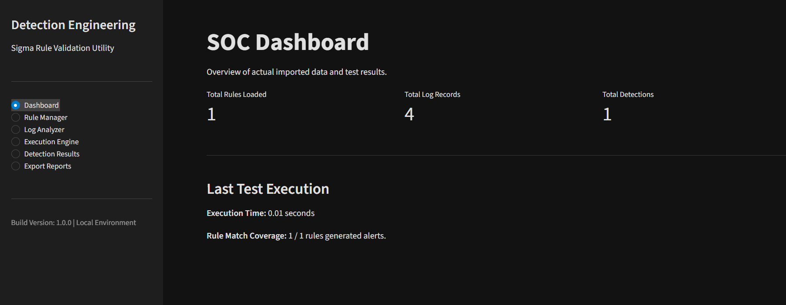
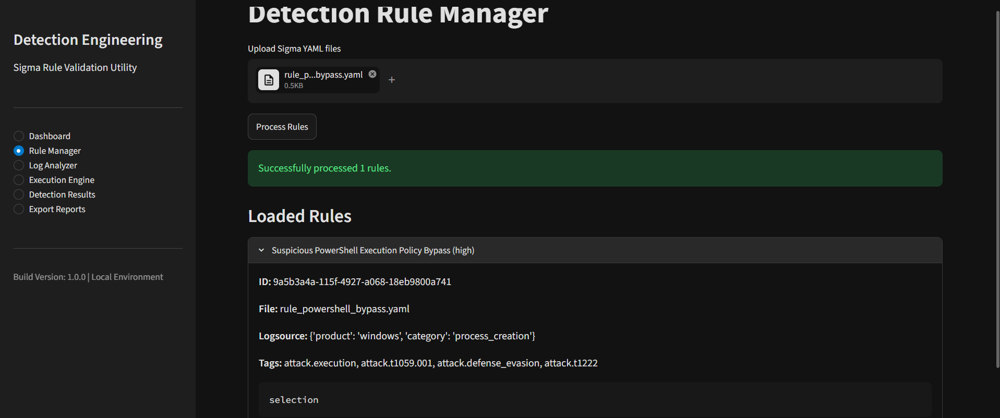
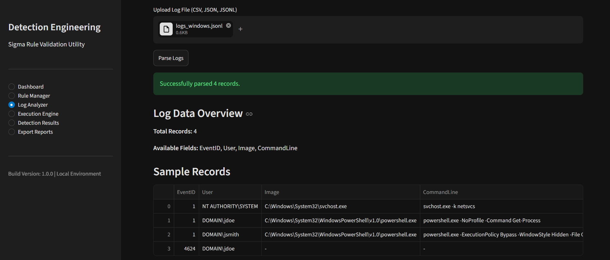
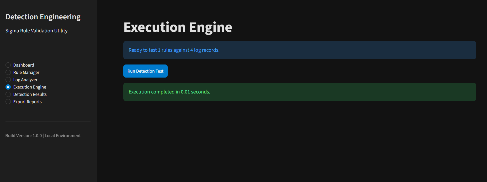
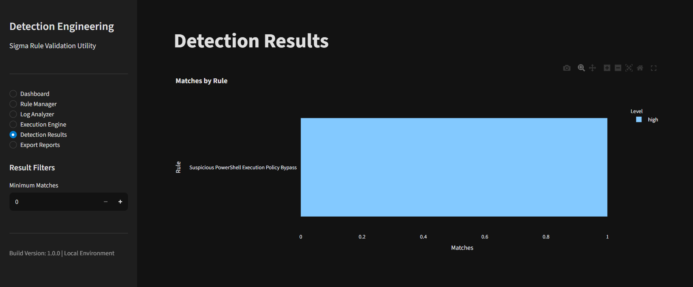
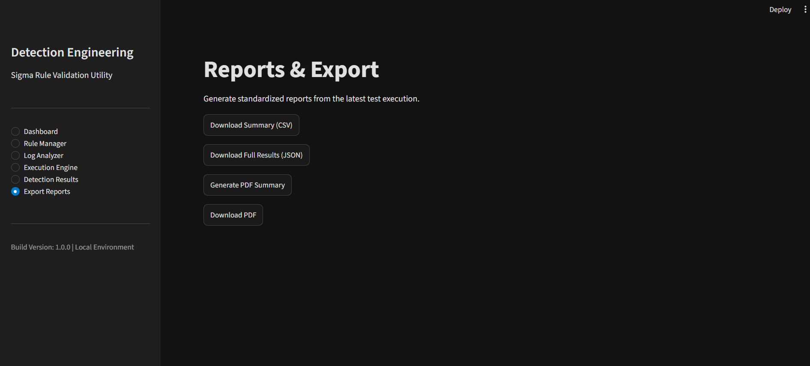

# Detection Rule Quality Tester

A lightweight, local tool for testing supported Sigma detection rules against security logs — without setting up a full SIEM environment.

The application lets you import Sigma YAML rules, load local log files, run detection checks, inspect matched events, and export the results.

## Overview

Detection rules need to be checked against relevant log data before they are used in a monitoring environment. This project provides a simple local workflow for testing a selected set of Sigma detection features.

**Main capabilities**

- Import and process Sigma YAML rules.
- Check required rule structure and display validation errors.
- Load JSON, JSONL, CSV, and raw text log files.
- Evaluate supported field modifiers and logical conditions.
- Review matched log records and rule-level results.
- Extract MITRE ATT&CK-related tags from imported rules.
- Export results in CSV, JSON, and PDF formats.
- Run core parsing and detection locally.

## Screenshots

### Dashboard


### Rule Manager


### Log Analyzer


### Execution Engine


### Detection Results


### Export Reports


## Supported Inputs

| Input | Description |
|---|---|
| YAML | Sigma detection rules |
| JSON | Structured security events |
| JSONL | One JSON record per line |
| CSV | Tabular log data |
| TXT | Raw text logs, including Syslog-style lines |

For raw text logs, the application maps available content into fields such as `CommandLine` and `Message`. The usefulness of this mapping depends on the source log format and the fields used by a rule.

## Supported Detection Logic

| Feature | Support |
|---|---|
| Exact field matching | Yes |
| `contains` | Yes |
| `startswith` | Yes |
| `endswith` | Yes |
| `re` regular expressions | Yes |
| Lists as OR alternatives | Yes |
| Wildcards (`*`) | Supported string patterns |
| `and`, `or`, `not` | Yes |
| Parenthesized conditions | Yes |
| Aggregations such as `count(x) > 5` | No |
| Time-based correlations | No |
| Nested field references | No |

This is an MVP with selected Sigma functionality, not a complete Sigma validator or Sigma-to-SIEM compiler.

## Project Structure

```text
Detection-Rule-Quality-Tester/
│
├── app.py
├── core/
│   ├── rule_parser.py
│   ├── sigma_conditions.py
│   └── detection_engine.py
├── modules/
│   ├── dashboard.py
│   ├── rule_manager.py
│   ├── log_analyzer.py
│   ├── execution_engine.py
│   ├── detection_results.py
│   └── export_reports.py
├── docs/
│   └── images/
│       ├── 01_dashboard.png
│       ├── 02_rule_manager.png
│       ├── 03_log_analyzer.png
│       ├── 04_execution.png
│       ├── 05_results.png
│       └── 06_reporting.png
├── requirements.txt
├── README.md
└── report.md
```

The structure above describes the modules covered in the project documentation. Adjust it if your current repository uses different filenames or contains additional files.

## Installation

### Requirements

- Python 3.11+
- pip
- A modern web browser
- Git (optional)

### 1. Clone the repository

```bash
git clone <repository-url>
cd Detection-Rule-Quality-Tester
```

### 2. Create a virtual environment

```bash
python -m venv venv
```

### 3. Activate the environment

**Windows PowerShell:**

```powershell
.\venv\Scripts\Activate.ps1
```

**Linux/macOS:**

```bash
source venv/bin/activate
```

### 4. Install dependencies

```bash
pip install -r requirements.txt
```

### 5. Start the application

```bash
python -m streamlit run app.py
```

Open the local URL shown in the terminal.

## How to Use

1. **Open the Rule Manager** and upload one or more Sigma YAML files.
2. **Process the rules** so the application can parse and validate them. Rules that have not been processed are not available for detection execution.
3. **Open the Log Analyzer** and upload JSON, JSONL, CSV, or TXT logs.
4. **Open the Execution Engine** and start detection evaluation.
5. **Review Detection Results** to inspect matched rules and the records that triggered them.
6. **Open Export Reports** to download available CSV, JSON, or PDF outputs.

## Core Modules

| File | Purpose |
|---|---|
| `core/rule_parser.py` | Parses Sigma YAML and checks rule structure |
| `core/sigma_conditions.py` | Implements supported field matching |
| `core/detection_engine.py` | Evaluates rule conditions against log records |
| `modules/dashboard.py` | Dashboard interface |
| `modules/rule_manager.py` | Rule upload and processing interface |
| `modules/log_analyzer.py` | Log import and parsing interface |
| `modules/execution_engine.py` | Detection execution interface |
| `modules/detection_results.py` | Detection result display |
| `modules/export_reports.py` | Report export interface |

## Privacy and Execution

The core rule parsing and detection workflow is designed to run locally. Uploaded rules and log data are not intended to be sent to external services.

Security logs can contain usernames, IP addresses, hostnames, authentication events, and other sensitive information. Keep datasets secure and do not expose the local Streamlit server to untrusted networks.

## Current Limitations

- This project supports only a selected subset of Sigma specifications.
- Aggregation-based detections are not supported.
- Time-based event correlation is not supported.
- Nested field references are not supported.
- Raw text normalization uses a limited field mapping.
- The tool does not deploy rules to a production SIEM.
- Large datasets may require more memory and processing time.
- It is intended for local testing, not continuous monitoring.

## Possible Future Improvements

- Wider Sigma specification support.
- Configurable log field mapping.
- MITRE ATT&CK visualization.
- Detection rule quality scoring.
- Better performance for large datasets.
- SIEM result comparison.
- Automated test case generation.
- More detailed detection coverage reports.

## Documentation

For the full project description, architecture, module details, workflow, supported specifications, testing plan, limitations, and references, see **[report.md](report.md)**.

## References

- [SigmaHQ](https://github.com/SigmaHQ/sigma)
- [Sigma Specification](https://github.com/SigmaHQ/sigma-specification)
- [MITRE ATT&CK](https://attack.mitre.org/)
- [Python Documentation](https://docs.python.org/3/)
- [Streamlit Documentation](https://docs.streamlit.io/)
- [Pandas Documentation](https://pandas.pydata.org/docs/)
- [PyYAML Documentation](https://pyyaml.org/wiki/PyYAMLDocumentation)

## Disclaimer

This project is intended for educational, research, and analytical purposes. Detection results depend on the rules, supported specifications, and log data provided. A successful local test does not guarantee identical behaviour in a production SIEM. Validate rules in a suitable staging environment before deployment.
