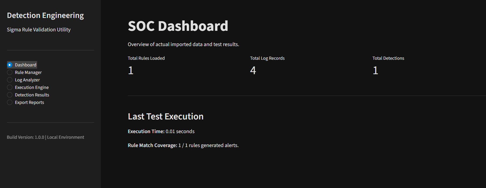
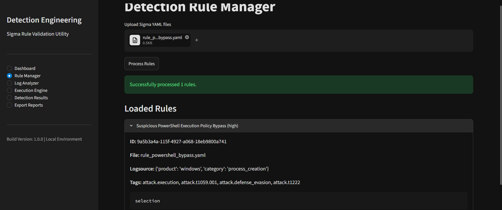
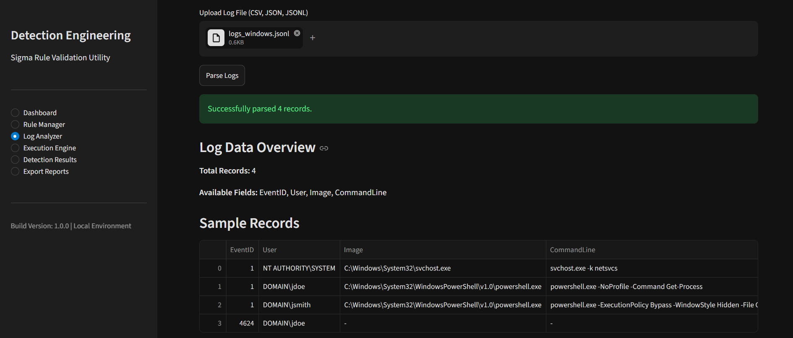
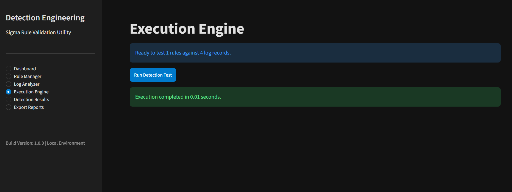
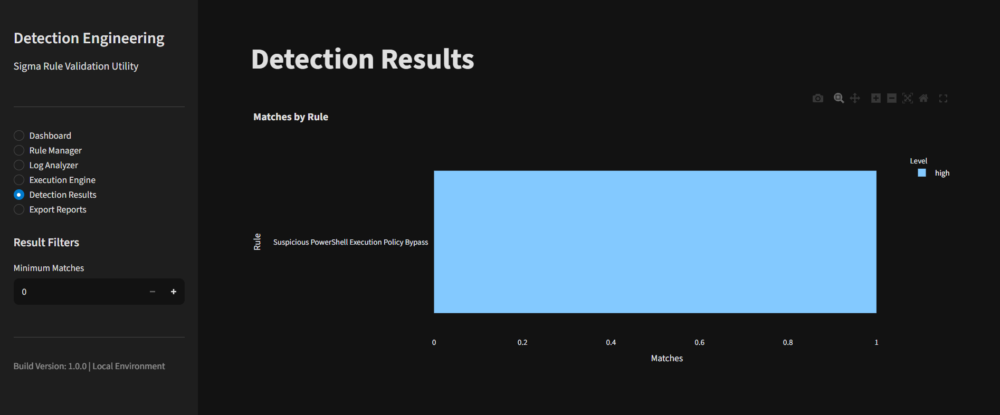
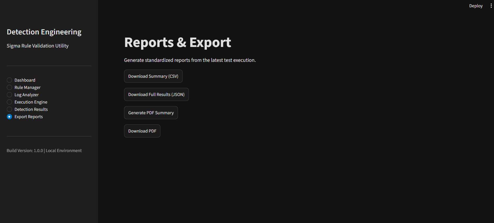

# Detection Rule Quality Tester
## A Local Sigma Detection Rule Validation and Testing Framework

**Project Report**

| Project Detail | Information |
|---|---|
| Project Title | Detection Rule Quality Tester |
| Project Category | Cybersecurity / SOC / Detection Engineering |
| Technology | Python, Sigma, Streamlit, Pandas, YAML |
| Application Type | Local web-based analytical utility |
| Execution Environment | Local environment |
| Submitted By | Kumar Satyam |
| Institution | Hackhalt |

---

## Abstract

Security Operations Centers (SOCs) use detection rules to identify suspicious activities from system, application, and network logs. Sigma provides a platform-independent way to describe detection logic in YAML. However, testing these rules can be difficult when a dedicated SIEM environment is not available.

The **Detection Rule Quality Tester** is a lightweight Python application that allows users to validate and test supported Sigma detection rules against local security log files. It provides a Streamlit interface for importing rules, loading logs, running detection checks, reviewing matched records, and exporting results.

The application supports JSON, JSONL, CSV, and raw text log inputs. Its detection logic handles selected Sigma-style matching operations, including exact matching, `contains`, `startswith`, `endswith`, regular expressions, lists, wildcards, and logical conditions. It also extracts MITRE ATT&CK-related information from tags present in imported rules.

The project uses a modular structure to keep the interface, rule parsing, condition matching, detection processing, and reporting separate. Core processing is designed to take place locally, without sending uploaded rules or log data to external services.

This tool is intended for learning, local rule testing, detection engineering practice, and threat-hunting workflows. It is an MVP and does not replace a production SIEM or a complete Sigma validation and conversion pipeline.

**Keywords:** Sigma, Detection Engineering, SOC, Threat Hunting, Log Analysis, MITRE ATT&CK, Python, YAML.

---

## Table of Contents

1. [Introduction](#1-introduction)
2. [Problem Statement](#2-problem-statement)
3. [Project Objectives](#3-project-objectives)
4. [Project Scope](#4-project-scope)
5. [Background and Technical Overview](#5-background-and-technical-overview)
6. [System Requirements](#6-system-requirements)
7. [System Architecture](#7-system-architecture)
8. [Module Description](#8-module-description)
9. [Implementation Methodology](#9-implementation-methodology)
10. [Application Workflow and User Guide](#10-application-workflow-and-user-guide)
11. [Supported Sigma Specifications](#11-supported-sigma-specifications)
12. [Testing and Validation](#12-testing-and-validation)
13. [Security and Privacy](#13-security-and-privacy)
14. [Limitations](#14-limitations)
15. [Future Enhancements](#15-future-enhancements)
16. [Conclusion](#16-conclusion)
17. [References](#17-references)
18. [Appendices](#18-appendices)

---

# 1. Introduction

## 1.1 Overview

Security monitoring involves reviewing system, application, and network events to identify activity that may indicate a security incident. SOC analysts use detection rules to search these events for known patterns and suspicious behaviour.

Sigma is a generic, YAML-based rule format used to describe detection logic independently of a specific SIEM platform. This makes it useful when working across different logging and monitoring environments.

The challenge is that a detection rule still needs to be checked against relevant log data. Setting up a full SIEM environment just to test a rule can take additional time and resources.

The Detection Rule Quality Tester addresses this by providing a local environment where users can load supported Sigma rules and test them against their own log files.

## 1.2 Project Overview

The application is built with Python and Streamlit. It provides a graphical interface for the main stages of the testing process.

Users can:

- Import Sigma rules in YAML format.
- Process and validate imported rules.
- Upload logs in JSON, JSONL, CSV, and TXT formats.
- Parse supported log records into a structured format.
- Run detection checks against the loaded records.
- Review the records matched by each rule.
- View rule severity and hit-count information.
- Extract MITRE ATT&CK-related tags from rules.
- Export results in CSV, JSON, and PDF formats.

The application is intended to run locally and does not require a production SIEM for its core workflow.

## 1.3 Why This Project

Detection rules should be checked before they are used in a monitoring environment. A rule may contain an invalid structure, refer to fields that are not present in the logs, or use detection logic that does not behave as expected.

A local testing utility makes it easier to review these issues using a small dataset and without setting up a complete SIEM stack.

The focus of this project is to make that testing process simpler and easier to follow.

---

# 2. Problem Statement

## 2.1 Existing Challenges

Testing detection rules can involve a number of practical difficulties:

1. **SIEM dependency:** A dedicated SIEM environment may be required to test rules in a realistic setup.
2. **Rule structure:** Incorrect YAML or missing detection fields can prevent a rule from being processed.
3. **Different log formats:** Security logs are available in different formats and may need to be normalized before testing.
4. **Detection verification:** Analysts need to identify which records match a particular rule and understand why they matched.
5. **Access to testing environments:** Students and individual researchers may not have access to a production-like SIEM.
6. **Result review:** Manually checking large sets of records can take time.

## 2.2 Proposed Solution

The proposed solution is a lightweight local application that brings rule parsing, log loading, detection evaluation, and result review into one interface.

Users import their Sigma YAML files and security logs. The application processes the supported formats, evaluates the supported detection conditions, and displays the matching records.

This provides a practical way to test selected detection logic without deploying a complete SIEM environment.

---

# 3. Project Objectives

The main objective is to build a local utility for testing supported Sigma detection rules against security log datasets.

The project objectives are:

1. Provide a simple interface for managing rules and log files.
2. Parse Sigma YAML files and check their required structure.
3. Support JSON, JSONL, CSV, and raw text log inputs.
4. Evaluate supported Sigma-style field modifiers.
5. Process logical conditions using controlled evaluation logic.
6. Identify and display records that match a rule.
7. Extract MITRE ATT&CK-related information from rule tags.
8. Show useful summaries of detection results.
9. Allow results to be exported in CSV, JSON, and PDF formats.
10. Keep the core processing workflow local.

---

# 4. Project Scope

## 4.1 Functional Scope

### A. Rule Management

- Upload one or more Sigma YAML files.
- Parse rule metadata and detection definitions.
- Check required rule fields.
- Display parsing and validation errors.
- Review imported rule logic.

### B. Log Processing

- Import supported log formats.
- Parse structured and unstructured records.
- Normalize raw text records into fields used by the application.
- Prepare records for detection evaluation.

### C. Detection Execution

- Evaluate supported field conditions.
- Apply string matching and regular expressions.
- Process supported logical operators.
- Identify records that match the imported rules.

### D. Result Analysis

- Display matched rules and records.
- Show rule-level detection statistics.
- Display severity and hit-count information.
- Extract relevant MITRE ATT&CK tags.

### E. Report Export

- Export tabular results as CSV.
- Export structured results as JSON.
- Generate PDF summary reports.

## 4.2 Intended Users

The tool is intended for:

- SOC analysts.
- Detection engineers.
- Threat hunters.
- Cybersecurity students.
- Security researchers.
- People learning Sigma rule development.

## 4.3 Project Boundaries

This project is a local detection-rule testing utility. It is not designed to replace a production SIEM, continuously monitor an environment, or provide a complete Sigma-to-SIEM compilation pipeline.

The current implementation supports a selected set of Sigma-style specifications. Rules that use unsupported features may not work as expected.

---

# 5. Background and Technical Overview

## 5.1 Sigma Detection Rules

Sigma is a generic rule format for describing security detections. Rules are commonly written in YAML and include metadata, log-source information, detection selections, and conditions.

Common rule fields include:

| Field | Purpose |
|---|---|
| `title` | Name of the detection rule |
| `id` | Rule identifier |
| `status` | Current rule status |
| `description` | Explanation of the detection |
| `logsource` | Describes the source of the relevant logs |
| `detection` | Contains selections and conditions |
| `level` | Indicates the rule severity |
| `tags` | Provides categorization and possible ATT&CK references |

The application reads these definitions and uses the supported detection logic during evaluation.

## 5.2 YAML Parsing

YAML is a human-readable data format. The project uses YAML parsing to read imported Sigma rule files and convert their contents into Python data structures.

The parsed data is then used for rule validation and detection processing.

## 5.3 Security Log Formats

Security events can be stored in different formats. The application supports the following input types:

| Format | Description |
|---|---|
| JSON | Structured event records |
| JSONL | One JSON object per line |
| CSV | Tabular log records |
| TXT | Raw text-based log records |
| Syslog text | Unstructured or semi-structured system log lines |

For raw text logs, the application maps available information into fields such as `CommandLine` and `Message`. The exact usefulness of this mapping depends on the content of the uploaded logs and the fields expected by a rule.

## 5.4 MITRE ATT&CK

MITRE ATT&CK is a knowledge base that describes adversary tactics and techniques. Sigma rules may include ATT&CK-related tags.

The application reads relevant tags from imported rules and displays the available ATT&CK context with detection results. The mapping depends on the tags supplied in each rule; the application does not independently infer an adversary technique from a log record.

---

# 6. System Requirements

## 6.1 Hardware Requirements

The application is intended to run on a standard computer capable of running Python.

| Component | Recommended Requirement |
|---|---|
| Processor | Dual-core processor or higher |
| RAM | 4 GB minimum; 8 GB recommended |
| Storage | Space for the application and uploaded datasets |
| Display | Standard desktop display |
| Network | Not required for core local processing |

Actual resource use depends on the size of the uploaded datasets and the number of rules being evaluated.

## 6.2 Software Requirements

| Software | Purpose |
|---|---|
| Python 3.11+ | Application runtime |
| Streamlit | User interface |
| Pandas | Data processing |
| PyYAML | YAML parsing |
| Git | Optional source-code management |
| Web browser | Access to the local Streamlit interface |

The project dependencies are listed in `requirements.txt`.

## 6.3 Technologies Used

- **Python:** Used for the application logic, parsing, and detection engine.
- **Streamlit:** Used to build the interactive interface.
- **Pandas:** Used to work with structured log records.
- **YAML:** Used as the input format for Sigma rules.
- **Regular expressions:** Used for supported pattern-based matching.

---

# 7. System Architecture

## 7.1 Architecture Overview

The application uses a modular structure. The Streamlit interface is kept separate from the core rule parsing and detection logic.

The main parts of the application are:

1. Presentation layer.
2. Rule processing layer.
3. Log processing layer.
4. Detection evaluation layer.
5. Results and reporting layer.

Each part has a defined responsibility and contributes to the overall workflow.

## 7.2 Main Components

### Presentation Layer

The presentation layer is built with Streamlit. It provides the dashboard, rule upload interface, log import interface, execution controls, results view, and report export options.

### Rule Processing Layer

This layer reads the imported Sigma YAML files, extracts their metadata and detection definitions, and checks the required structure before rules are used by the engine.

### Log Processing Layer

This layer reads uploaded log files, identifies the supported format, parses the records, and prepares them for evaluation.

### Detection Evaluation Layer

The detection engine compares parsed records against the supported conditions in the imported rules. It applies field matching and logical evaluation to identify matches.

### Results and Reporting Layer

This layer presents matched records and rule-level information. It also provides the available export formats.

## 7.3 Project Structure

The following is the project structure described for this application. Update it if the actual repository contains additional or differently named files.

```text
Detection-Rule-Quality-Tester/
│
├── app.py
│
├── core/
│   ├── rule_parser.py
│   ├── sigma_conditions.py
│   └── detection_engine.py
│
├── modules/
│   ├── dashboard.py
│   ├── rule_manager.py
│   ├── log_analyzer.py
│   ├── execution_engine.py
│   ├── detection_results.py
│   └── export_reports.py
│
├── docs/
│   └── images/
│       ├── 01_dashboard.png
│       ├── 02_rule_manager.png
│       ├── 03_log_analyzer.png
│       ├── 04_execution.png
│       ├── 05_results.png
│       └── 06_reporting.png
│
├── requirements.txt
├── README.md
└── report.md
```

---

# 8. Module Description

## 8.1 Main Application — `app.py`

`app.py` is the application entry point. It initializes the Streamlit interface, configures the application, manages navigation, and loads the relevant modules.

## 8.2 Rule Parser — `core/rule_parser.py`

The rule parser handles imported Sigma YAML files.

Its responsibilities include:

- Reading YAML files.
- Extracting rule metadata.
- Reading detection definitions.
- Checking required fields.
- Reporting structural validation errors.
- Preparing valid rule definitions for further processing.

The application checks fields such as `detection` and `condition` during rule validation.

## 8.3 Sigma Conditions — `core/sigma_conditions.py`

This module contains the matching logic for supported field modifiers.

The supported operations include:

- **Exact match:** Compares a log field with an expected value.
- **Contains:** Checks whether a field contains a specified substring.
- **Startswith:** Checks whether a field begins with a specified value.
- **Endswith:** Checks whether a field ends with a specified value.
- **Regular expression:** Checks a field against a regular expression.
- **Wildcard:** Handles supported wildcard patterns.
- **Lists:** Evaluates multiple values as OR-style alternatives.

## 8.4 Detection Engine — `core/detection_engine.py`

The detection engine is responsible for evaluating imported rules against parsed log records.

Its responsibilities include:

- Receiving validated rules.
- Reading structured log records.
- Applying field-level matching.
- Evaluating supported logical conditions.
- Identifying matching records.
- Associating matches with their corresponding rules.
- Returning results for display and export.

The engine uses in-memory processing for local evaluation.

## 8.5 User Interface Modules — `modules/`

The `modules` directory contains the Streamlit interface components.

| Module | Responsibility |
|---|---|
| Dashboard | Shows the current application state and summary information |
| Rule Manager | Imports, processes, and displays Sigma rules |
| Log Analyzer | Imports and previews security logs |
| Execution Engine | Starts detection evaluation |
| Detection Results | Displays matched records and rule statistics |
| Export Reports | Provides CSV, JSON, and PDF export options |

---

# 9. Implementation Methodology

## 9.1 Development Approach

The application is divided into separate components so that each part can be maintained and improved independently.

The implementation workflow is organized into the following stages.

### Stage 1: Application Setup

- Set up the Python environment.
- Install project dependencies.
- Initialize the Streamlit application.
- Organize the project files.

### Stage 2: Rule Parsing

- Read Sigma YAML files.
- Extract rule metadata.
- Check required rule fields.
- Identify invalid rule structures.

### Stage 3: Log Processing

- Identify the uploaded file format.
- Parse JSON and JSONL records.
- Load CSV records.
- Process raw text and Syslog-style lines.
- Normalize supported records.

### Stage 4: Detection Logic

- Implement supported field modifiers.
- Add string and regular-expression matching.
- Evaluate supported logical conditions.
- Connect the condition logic with the detection engine.

### Stage 5: Result Analysis

- Associate matching records with rules.
- Prepare detection summaries.
- Display rule metadata and ATT&CK tags.
- Provide result filters.

### Stage 6: Reporting

- Prepare CSV exports.
- Prepare JSON exports.
- Generate PDF summary reports.

## 9.2 Detection Workflow

The main execution process follows these steps:

1. The user imports Sigma YAML files.
2. The rule parser reads and validates the rule definitions.
3. The user imports a security log dataset.
4. The log parser converts supported records into a structured format.
5. The user starts detection execution.
6. The engine evaluates supported field conditions.
7. The engine evaluates the rule's logical condition.
8. Matching records are collected.
9. Results are displayed in the application.
10. The user can export the results.

## 9.3 Logical Condition Evaluation

Sigma rules can combine selections and filters using logical operators.

The application supports:

- `and`
- `or`
- `not`
- Parenthesized expressions

For example:

```text
selection1 and not filter1
```

This condition requires `selection1` to match while `filter1` does not match.

The application uses its own localized condition-processing logic. It is not intended to execute arbitrary expressions supplied in a rule.

---

# 10. Application Workflow and User Guide

## 10.1 Installation and Setup

### Prerequisites

- Python 3.11 or higher.
- Git (optional).
- A compatible operating system.
- A modern web browser.

### Step 1: Get the Project

Clone the repository or download the source code to the local machine.

### Step 2: Create a Virtual Environment

```bash
python -m venv venv
```

### Step 3: Activate the Environment

**Windows:**

```powershell
.\venv\Scripts\activate
```

**Linux/macOS:**

```bash
source venv/bin/activate
```

### Step 4: Install Dependencies

```bash
pip install -r requirements.txt
```

### Step 5: Run the Application

```bash
python -m streamlit run app.py
```

Streamlit will display the local address in the terminal. Open that address in a browser to use the application.

## 10.2 Dashboard

The dashboard gives users an overview of the current application state. It displays information such as the number of loaded rules, parsed log records, and the latest execution results.



*Figure 10.1 — Dashboard: overview of loaded rules, parsed records, and execution information.*

## 10.3 Loading Detection Rules

Open the Rule Manager and upload one or more Sigma YAML files. After uploading, select the rule processing option to parse and validate the rules.

The application checks the imported rules for required fields and displays validation errors when it finds structural issues. Users can expand a rule to review its imported logic.

**Important:** A rule must be processed before it can be used during log evaluation.



*Figure 10.2 — Rule Manager: import, process, validate, and review Sigma rules.*

## 10.4 Importing Security Logs

Open the Log Analyzer to upload local security log files.

Supported extensions:

- `.json`
- `.jsonl`
- `.csv`
- `.txt`

For raw text logs, such as Linux authentication logs, the parser maps available content into fields such as `CommandLine` and `Message`. This makes the records available to the supported detection logic, although the resulting field mapping may not cover every log source.



*Figure 10.3 — Log Analyzer: upload and inspect supported security log formats.*

## 10.5 Running Detection Rules

Once the rules have been processed and the logs have been loaded, open the Execution Engine and start the evaluation.

The engine checks the supported Sigma conditions against the loaded records and collects the matching events.



*Figure 10.4 — Execution Engine: run processed rules against the loaded log records.*

## 10.6 Reviewing Detection Results

The Detection Results page displays the output of the evaluation.

Users can review:

- Matched detection rules.
- Matching log records.
- Rule severity.
- Detection hit counts.
- Available MITRE ATT&CK tags.
- Statistical summaries.

Expanding a matched rule displays the records associated with that detection. Sidebar filters can be used to organize the results by severity and hit count.



*Figure 10.5 — Detection Results: inspect matched events and review rule-level information.*

## 10.7 Exporting Reports

Open Export Reports to generate downloadable output files.

The application supports:

- **CSV:** For tabular analysis.
- **JSON:** For structured data and further processing.
- **PDF:** For a summary that can be shared or documented.



*Figure 10.6 — Export Reports: generate downloadable detection summaries and result files.*

---

# 11. Supported Sigma Specifications

## 11.1 Supported Field Matching

The current implementation supports the following matching operations:

| Specification | Description |
|---|---|
| Exact match | Compares a field with an expected value |
| `contains` | Checks for a substring |
| `startswith` | Checks the beginning of a field |
| `endswith` | Checks the end of a field |
| `re` | Performs regular-expression matching |
| Lists | Evaluates multiple values as OR alternatives |
| Wildcards (`*`) | Supports wildcard patterns in string values |

## 11.2 Supported Logical Conditions

| Operator | Meaning |
|---|---|
| `and` | All required conditions must match |
| `or` | At least one condition must match |
| `not` | Negates a condition |
| Parentheses | Groups expressions and controls evaluation order |

Example:

```text
selection1 and not filter1
```

The expression requires the selection to match and the filter not to match.

## 11.3 Unsupported Specifications

This project is an MVP and does not implement the complete Sigma specification.

The following features are currently outside the stated scope:

### Aggregations

Examples such as:

```text
count(x) > 5
```

are not supported.

### Time-Based Correlations

The application does not correlate multiple events across a time window.

### Nested Field References

Dynamic field references such as:

```text
Field1: '%Field2%'
```

are not supported.

## 11.4 Compatibility Note

The application supports a selected subset of Sigma functionality. It should not be treated as a complete Sigma validator or a replacement for official Sigma tooling.

Rules that use unsupported features may need to be adapted or tested with a compatible Sigma backend.

---

# 12. Testing and Validation

## 12.1 Testing Objective

Testing is used to check whether the individual modules and the complete workflow behave as expected.

The main areas for testing are rule parsing, log parsing, detection evaluation, result display, and report generation.

## 12.2 Test Categories

### Rule Parsing

Check whether the application can:

- Import valid YAML files.
- Extract rule metadata.
- Identify missing required fields.
- Handle invalid YAML.
- Process multiple rule files.

### Log Parsing

Check whether the application can:

- Read JSON records.
- Process JSONL files.
- Import CSV records.
- Read raw text logs.
- Handle empty or malformed records.

### Detection Engine

Check the evaluation of:

- Exact matching.
- `contains`.
- `startswith`.
- `endswith`.
- Regular expressions.
- Lists of values.
- `and`, `or`, and `not`.
- Parenthesized conditions.

### Results and Reporting

Check whether:

- Matching records are displayed.
- Detection statistics are generated.
- Rule metadata is retained.
- CSV exports are readable.
- JSON exports preserve structured information.
- PDF reports are generated.

## 12.3 Test Case Plan

The following table is a test plan. Record the actual status and observations after running each test.

| Test ID | Test Scenario | Expected Result | Actual Status |
|---|---|---|---|
| TC-01 | Import valid Sigma YAML | Rule is parsed | To be recorded |
| TC-02 | Import invalid YAML | Validation error is displayed | To be recorded |
| TC-03 | Omit the detection field | Rule validation fails | To be recorded |
| TC-04 | Upload JSON dataset | Records are parsed | To be recorded |
| TC-05 | Upload CSV dataset | Tabular records are loaded | To be recorded |
| TC-06 | Upload raw text logs | Records are processed | To be recorded |
| TC-07 | Evaluate exact match | Matching records are identified | To be recorded |
| TC-08 | Evaluate `contains` | Matching records are identified | To be recorded |
| TC-09 | Evaluate logical AND | All required conditions match | To be recorded |
| TC-10 | Evaluate logical NOT | Negated condition is applied | To be recorded |
| TC-11 | Export CSV | CSV file is generated | To be recorded |
| TC-12 | Export JSON | JSON file is generated | To be recorded |
| TC-13 | Export PDF | PDF file is generated | To be recorded |

> **Note:** These are proposed test cases. Do not mark them as passed until they have been executed and verified.

---

# 13. Security and Privacy

## 13.1 Local Processing

The application is designed to process imported rules and logs within the local execution environment. Its core parsing and detection workflow does not require an external endpoint.

This reduces the need to transfer potentially sensitive log data to third-party services.

## 13.2 Handling Security Logs

Security logs may contain sensitive information, including:

- Usernames.
- IP addresses.
- Hostnames.
- Authentication events.
- System paths.
- Application activity.

Users should handle uploaded datasets carefully and avoid sharing sensitive records unnecessarily.

## 13.3 Safe Rule Evaluation

Imported YAML files and rule conditions should be treated as untrusted input.

The application should validate imported structures and use controlled condition evaluation rather than unrestricted execution of user-supplied expressions.

Regular expressions should also be handled carefully because poorly designed patterns can consume excessive processing time.

## 13.4 Local Application Access

The application is intended for local analytical use. Users should avoid exposing the Streamlit development server to untrusted networks and should restrict access to the machine running the application.

---

# 14. Limitations

The current version has the following limitations:

1. **Partial Sigma support:** Only a selected subset of Sigma specifications is supported.
2. **No aggregation support:** Count-based and aggregation-driven conditions are not implemented.
3. **No time-based correlation:** Events are not correlated across time windows.
4. **Limited field mapping:** Raw text logs are mapped into a limited set of fields, which may not match every rule's expected schema.
5. **No direct SIEM integration:** The application does not deploy rules to production SIEM platforms.
6. **Dataset dependency:** Results depend on the quality, structure, and completeness of the uploaded logs.
7. **Processing limits:** Large datasets may require additional memory and processing time.
8. **No continuous monitoring:** The application is designed for offline testing, not continuous SOC monitoring.

---

# 15. Future Enhancements

The following improvements can be considered for later versions.

## 15.1 Wider Sigma Support

Add more Sigma modifiers, advanced condition expressions, and aggregation-based detection support.

## 15.2 Better Log Normalization

Add configurable field mapping profiles for different operating systems, applications, and log sources.

## 15.3 MITRE ATT&CK Visualization

Provide a visual view of the tactics and techniques referenced by imported detection rules.

## 15.4 Detection Rule Quality Scoring

Add a quality assessment feature based on structural validation, field availability, condition complexity, and test coverage.

## 15.5 Performance Improvements

Explore chunk-based processing and parallel execution for larger datasets.

## 15.6 SIEM Compatibility

Explore ways to compare local test results with the behaviour of rules in platforms such as Splunk, Elastic Security, and Microsoft Sentinel.

## 15.7 Automated Test Case Generation

Generate test cases from detection definitions to help improve rule coverage.

## 15.8 Improved Reporting

Add detection coverage summaries, rule validation statistics, ATT&CK mappings, execution summaries, and detailed matched-event analysis.

---

# 16. Conclusion

The Detection Rule Quality Tester provides a local way to test supported Sigma detection rules against security log datasets.

The project brings rule parsing, log processing, condition evaluation, result analysis, and report export into one application. This makes it possible to test selected detection logic without setting up a complete SIEM environment.

The modular structure keeps the interface separate from the core processing components and makes the application easier to maintain and extend.

The current implementation supports commonly used matching operations and logical conditions, along with extraction of MITRE ATT&CK-related tags from imported rules. It also has clear limitations, particularly around aggregation, time-based correlation, and full Sigma compatibility.

Overall, the project applies Python programming, log analysis, detection engineering, and cybersecurity automation to a practical SOC-related use case. It can serve as a starting point for further work on detection validation and testing.

---

# 17. References

1. SigmaHQ — Sigma: Generic Signature Format for SIEM Systems.  
   https://github.com/SigmaHQ/sigma

2. MITRE — MITRE ATT&CK Framework.  
   https://attack.mitre.org/

3. Python Software Foundation — Python Documentation.  
   https://docs.python.org/3/

4. Streamlit — Streamlit Documentation.  
   https://docs.streamlit.io/

5. Pandas — Pandas Documentation.  
   https://pandas.pydata.org/docs/

6. PyYAML — PyYAML Documentation.  
   https://pyyaml.org/wiki/PyYAMLDocumentation

7. SigmaHQ — Sigma Rule Specification.  
   https://github.com/SigmaHQ/sigma-specification

---

# 18. Appendices

## Appendix A — Application Commands

Create a virtual environment:

```bash
python -m venv venv
```

Activate it on Windows:

```powershell
.\venv\Scripts\activate
```

Install dependencies:

```bash
pip install -r requirements.txt
```

Run the application:

```bash
python -m streamlit run app.py
```

## Appendix B — Screenshot Reference

All screenshots used in this report are referenced using repository-relative paths. GitHub will display them when the files exist at the listed locations and the filename capitalization matches.

| Figure | Image Path | Description |
|---|---|---|
| 10.1 | `docs/images/01_dashboard.png` | Application dashboard and overview |
| 10.2 | `docs/images/02_rule_manager.png` | Sigma rule upload, processing, and validation |
| 10.3 | `docs/images/03_log_analyzer.png` | Security log upload and parsed records |
| 10.4 | `docs/images/04_execution.png` | Detection execution interface |
| 10.5 | `docs/images/05_results.png` | Matched events and detection statistics |
| 10.6 | `docs/images/06_reporting.png` | CSV, JSON, and PDF report export |

## Appendix C — Disclaimer

This software is intended for educational, research, and analytical purposes.

The results depend on the imported Sigma rules, the specifications supported by the application, and the quality of the supplied log data. A successful local evaluation does not guarantee identical behaviour in a production SIEM environment.

Detection rules should be validated in a staging environment that reflects the intended production logging architecture before deployment.

---

**End of Report**
